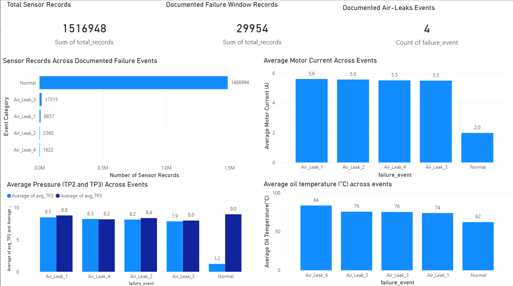
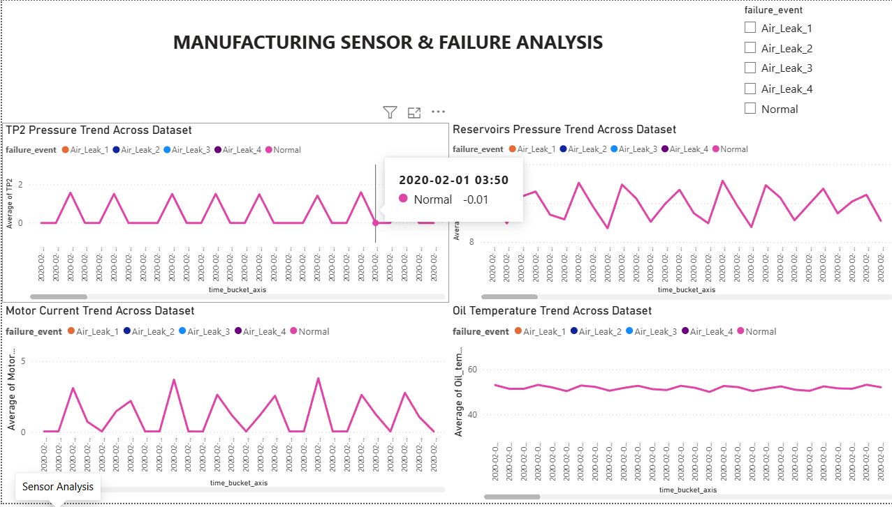

# Manufacturing Downtime & Root Cause Intelligence

**Industrial Sensor Analytics | Python | SQL | SQLite | Power BI**

An industrial sensor data analytics project focused on investigating compressor performance, analysing sensor behaviour, and identifying patterns associated with documented air-leak events using Python, SQL, and Power BI.

---

## Project Overview

Industrial equipment continuously generates sensor readings that can help understand equipment behaviour and identify unusual operating conditions.

However, analysing large volumes of sensor data manually can be challenging.

This project uses the **MetroPT-3 Air Compressor Dataset** to investigate sensor behaviour during documented air-leak periods. It combines data preprocessing, exploratory data analysis, SQL-based investigation, operating-state comparison, rule-based sensor analysis, chronological validation, and interactive Power BI dashboards.

The goal is to transform raw industrial sensor data into meaningful analytical insights that can support equipment monitoring and maintenance investigation.

## Project Objectives

- Process and validate large-scale industrial sensor data.
- Analyse sensor behaviour during normal and documented air-leak periods.
- Investigate pressure, temperature, and motor current variations.
- Perform structured analysis using SQL.
- Compare sensor readings under similar operating conditions.
- Develop a rule-based sensor investigation method.
- Evaluate the investigation method using chronological validation.
- Build interactive Power BI dashboards to communicate findings.

## Dataset Description

**Dataset:** MetroPT-3 Air Compressor Dataset  
**Source:** UCI Machine Learning Repository  
**Equipment:** Air Production Unit (APU) compressor installed in a metro train.

The dataset contains approximately 1.5 million sensor observations collected between February and September 2020.

### Important sensor variables

| Variable | Description |
|---|---|
| TP2 | Compressor pressure measurement |
| TP3 | Pressure measurement |
| H1 | Pressure-related sensor measurement |
| Reservoirs | Air reservoir pressure |
| Oil_temperature | Compressor oil temperature |
| Motor_current | Electrical current drawn by the motor |
| DV_eletric | Electrical valve state |
| COMP | Compressor state indicator |
| Towers | Tower operating-state indicator |
| LPS | Low-pressure switch signal |
| MPG | Compressor-related operating indicator |

The dataset contains four documented air-leak periods:

- Air_Leak_1
- Air_Leak_2
- Air_Leak_3
- Air_Leak_4

These documented time windows were used to categorise observations for retrospective analysis.

**Dataset limitation:** The event categories represent documented time windows, not independently verified fault labels for every individual sensor observation.

## Technology Stack

| Technology | Application |
|---|---|
| Python | Data processing and analysis |
| Pandas | Data cleaning and manipulation |
| NumPy | Numerical calculations |
| Matplotlib | Data visualisation |
| Seaborn | Statistical visualisation |
| SQL | Structured data analysis |
| SQLite | Database storage |
| Power BI | Interactive dashboard development |
| VS Code | Development environment |
| Git & GitHub | Version control and project hosting |

## Project Workflow

### 1. Data Inspection and Cleaning

Python and Pandas were used to inspect and preprocess the original dataset.

Activities included:

- Inspecting dataset dimensions and column information.
- Converting timestamps into datetime format.
- Checking missing values and invalid timestamps.
- Validating record ordering.
- Creating event categories using documented air-leak periods.
- Exporting cleaned and labelled datasets.

**Data preparation results:**

| Metric | Result |
|---|---:|
| Total observations | 1,516,948 |
| Missing values | 0 |
| Invalid timestamps | 0 |
| Documented event-window observations | 29,954 |
| Normal-labelled observations | 1,486,994 |

### 2. Exploratory Data Analysis (EDA)

Exploratory Data Analysis was performed to understand how sensor readings varied across different event categories.

The analysis focused on:

- TP2 and TP3 pressure readings.
- Air reservoir pressure.
- Oil temperature.
- Motor current.
- Sensor trends over time.

Visualisations were created to compare sensor behaviour during normal and documented air-leak periods.

### 3. SQL-Based Analysis

The processed dataset was stored in an SQLite database named `manufacturing.db`.

A structured table called `sensor_readings` was created for querying and analysis.

SQL was used to investigate:

- Total sensor records.
- Event-category distribution.
- Date ranges.
- Average sensor readings across event categories.
- Operating-state comparisons.
- Event-specific sensor summaries.

### 4. Operating-State Analysis

Sensor readings can change depending on equipment operating conditions. Therefore, comparing all observations directly may produce misleading results.

An additional analysis was performed by comparing observations where `DV_eletric = 1`.

This helped reduce differences associated with this particular operating-state indicator.

**State-matched sensor comparison:**

| Category | TP3 Average | Reservoir Average | Oil Temperature Average |
|---|---:|---:|---:|
| Normal | 8.9515 | 8.9501 | 64.93 |
| Air_Leak_1 | 8.8179 | 8.8190 | 74.39 |
| Air_Leak_2 | 8.3900 | 8.3920 | 75.88 |
| Air_Leak_3 | 8.0182 | 8.0201 | 75.52 |
| Air_Leak_4 | 8.1749 | 8.1725 | 84.12 |

**Key observations:**

- Oil temperature was higher across all four documented event periods compared with normal operation.
- TP3 and reservoir pressure were lower during Air_Leak_2 and Air_Leak_3.
- Air_Leak_4 showed the highest average oil temperature.

This comparison controls for `DV_eletric` only. Other operating conditions may also influence sensor behaviour.

### 5. Rule-Based Sensor Investigation

A threshold-based investigation method was developed using pressure and temperature measurements.

Reference thresholds were calculated using sampled normal operating records where `DV_eletric = 1`.

**Reference thresholds:**

| Sensor | Threshold | Condition |
|---|---:|---|
| TP3 | 8.0780 | Below threshold |
| Reservoirs | 8.0800 | Below threshold |
| Oil_temperature | 73.7000 | Above threshold |

**Investigation logic:**

1. Check whether TP3 is below its threshold.
2. Check whether reservoir pressure is below its threshold.
3. Check whether oil temperature exceeds its threshold.
4. Generate a combined alert when both the pressure condition and temperature condition are satisfied.

The pressure condition requires both TP3 and reservoir pressure to be below their respective thresholds.

This is a manually designed rule-based investigation method, not a trained machine learning model.

**Results across the complete dataset:**

| Category | Records | Combined Alerts | Alert Rate |
|---|---:|---:|---:|
| Normal | 213,837 | 5,436 | 2.542% |
| Air_Leak_1 | 8,566 | 0 | 0% |
| Air_Leak_2 | 2,341 | 4 | 0.171% |
| Air_Leak_3 | 17,315 | 8,170 | 47.185% |
| Air_Leak_4 | 1,579 | 763 | 48.322% |

These results show that combined pressure and temperature alerts occurred more frequently during Air_Leak_3 and Air_Leak_4 than during normal observations.

### 6. Chronological Validation

A chronological validation experiment was performed to investigate whether thresholds derived from historical normal observations could identify relevant patterns in a later period.

The dataset was divided using a cutoff date of **1 June 2020**.

- Historical reference period: Before 1 June 2020.
- Validation period: From 1 June 2020 onward.
- Historical normal records: 113,237.
- Reference sample used for threshold calculation: 45,000.
- Validation records with `DV_eletric = 1`: 119,494.

**Thresholds calculated from historical data:**

| Sensor | Threshold |
|---|---:|
| TP3 | 8.0540 |
| Reservoirs | 8.0560 |
| Oil_temperature | 74.2250 |

**Chronological validation results:**

| Category | Records | Combined Alerts | Alert Rate |
|---|---:|---:|---:|
| Normal | 100,600 | 440 | 0.437% |
| Air_Leak_3 | 17,315 | 7,337 | 42.374% |
| Air_Leak_4 | 1,579 | 755 | 47.815% |

**Interpretation:**

The combined alert condition occurred substantially more frequently during Air_Leak_3 and Air_Leak_4 than during normal observations in the validation period.

This indicates that the selected sensor conditions may be useful for retrospective investigation of certain air-leak patterns.

**Important limitation:** This is not a fully independent predictive benchmark because the investigation rules were selected after exploratory analysis of the dataset. Validation covers Air_Leak_3 and Air_Leak_4 only. The alert rates should not be interpreted as prediction accuracy, precision, recall, or proof of real-time fault detection.

## Power BI Dashboard

An interactive two-page dashboard was developed using Power BI Desktop to present the analytical findings.

### Page 1 – Event Overview



The first page provides an overview of the dataset and documented air-leak event distribution.

**Key components:**

- Total sensor records.
- Documented failure-window records.
- Documented air-leak events.
- Sensor record distribution across event categories.
- Average motor current across events.
- Average pressure (TP2 and TP3) across events.
- Average oil temperature across events.

### Page 2 – Sensor Analysis



The second page focuses on sensor trends over time.

**Key components:**

- TP2 pressure trend.
- Reservoir pressure trend.
- Motor current trend.
- Oil temperature trend.
- Event-category slicer for interactive filtering.

The dashboard makes it easier to explore sensor behaviour and compare different documented event categories.

## Repository Structure

```text
manufacturing-downtime-intelligence/
│
├── data/
│   ├── raw/
│   └── processed/
│
├── src/
│   ├── inspect_data.py
│   ├── clean_data.py
│   ├── validate_data.py
│   ├── label_failures.py
│   ├── analyze_failures.py
│   ├── anomaly_detection.py
│   ├── create_database.py
│   ├── run_sql_analysis.py
│   ├── operating_state_analysis.py
│   ├── operating_state_diagnostic.py
│   ├── state_matched_analysis.py
│   ├── load_matched_analysis.py
│   ├── sensor_rule_investigation.py
│   ├── chronological_validation.py
│   ├── failure_visualization.py
│   ├── plot_comparison.py
│   ├── plot_sensor_groups.py
│   └── export_powerbi_data.py
│
├── sql/
│   └── analysis_queries.sql
│
├── powerbi/
│   ├── Manufacturing_Downtime_Dashboard.pbix
│   ├── data/
│   └── screenshots/
│       ├── dashboard_overview.png
│       └── sensor_analysis.png
│
├── reports/
│   ├── chronological_validation_summary.csv
│   ├── chronological_validation_thresholds.csv
│   ├── sensor_investigation_summary.csv
│   ├── sensor_rule_thresholds.csv
│   ├── state_matched_sensor_comparison.csv
│   ├── state_matched_sensor_summary.csv
│   └── visualisation files
│
├── requirements.txt
├── .gitignore
└── README.md
```

## How to Run the Project

### 1. Clone the repository

```bash
git clone https://github.com/Ananya473/manufacturing-downtime-intelligence.git

cd manufacturing-downtime-intelligence
```

### 2. Create a virtual environment

```bash
python -m venv .venv
```

### 3. Activate the environment

For Windows PowerShell:

```powershell
.\.venv\Scripts\Activate.ps1
```

### 4. Install dependencies

```bash
pip install -r requirements.txt
```

### 5. Download the dataset

Download the MetroPT-3 Air Compressor dataset from the UCI Machine Learning Repository.

Place the original CSV file at:

```text
data/raw/MetroPT3(AirCompressor).csv
```

### 6. Execute the analysis

Run the Python scripts from the project root directory in the appropriate workflow order.

The scripts in `src/` cover:

- Data inspection and cleaning.
- Timestamp validation.
- Event labelling.
- Exploratory analysis.
- Database creation and SQL analysis.
- Operating-state comparison.
- Rule-based sensor investigation.
- Chronological validation.
- Power BI data export.

The Power BI dashboard can be opened using Power BI Desktop.

## Project Limitations

- The dataset represents one compressor unit rather than multiple independent manufacturing machines.
- The documented air-leak periods are time-window labels, not independently verified labels for every observation.
- The dataset does not contain repair start and end times or production output.
- MTTR, MTBF, and OEE cannot be reliably calculated using the available data.
- The rule-based method is intended for retrospective investigation, not established real-time prediction.
- Chronological validation covers two documented air-leak periods and is not a fully independent predictive benchmark.
- Operating-state matching controls for `DV_eletric` only; other operating conditions may influence the results.

## Future Scope

- Evaluate the investigation method on additional industrial datasets.
- Incorporate confirmed maintenance logs and fault labels.
- Explore independently validated machine learning models.
- Develop real-time sensor monitoring and alerting.
- Integrate the analysis with maintenance management systems.
- Incorporate production and repair data to calculate reliable maintenance KPIs.

## Conclusion

This project demonstrates how large-scale industrial sensor data can be processed and analysed to investigate equipment behaviour during documented air-leak periods.

By combining Python, SQL, SQLite, and Power BI, the project transforms raw sensor readings into structured analysis, sensor comparisons, rule-based investigation results, and interactive visualisations.

The analysis identified differences in pressure and oil temperature across documented event categories. Chronological validation also showed a higher frequency of combined pressure and temperature alerts during Air_Leak_3 and Air_Leak_4 than during normal observations.

Overall, the project provides a practical foundation for industrial sensor analytics and further development in predictive maintenance.

---

**Developed using Python | SQL | SQLite | Power BI**

**GitHub Repository:** https://github.com/Ananya473/manufacturing-downtime-intelligence